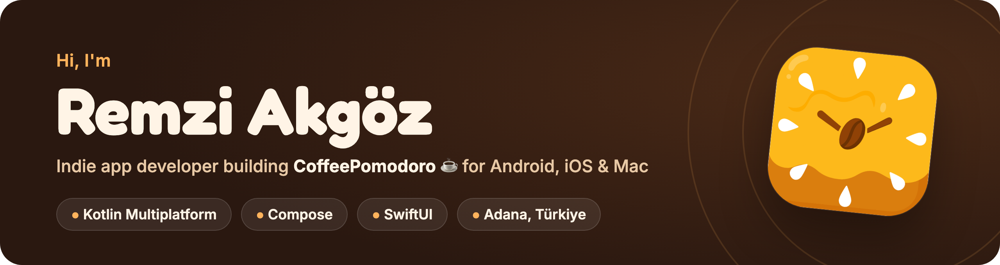
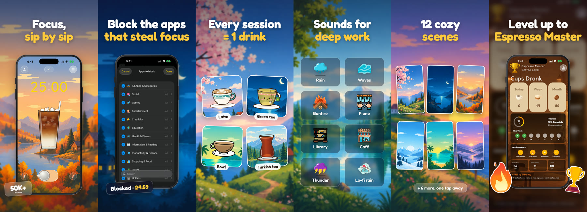

<picture>
  <source media="(prefers-color-scheme: dark)" srcset="assets/banner-dark.png" />
  <source media="(prefers-color-scheme: light)" srcset="assets/banner-light.png" />
  
</picture>

 

I build small, cozy apps on my own, from the first line of code to the store page and the reply to your review. Most of my days go into **CoffeePomodoro**, a focus timer where every session fills a cup. It runs on Android, iOS and the Mac from one Kotlin Multiplatform codebase, with a native SwiftUI app on the Mac.

I write about it every week in public, numbers and mistakes included.

## ☕ CoffeePomodoro

A Pomodoro timer that feels like a coffee break. Pick a drink, focus while it drains, and watch your cups add up.

- **50K+ downloads** and a **4.9 ★** rating on Google Play
- Available in **44 languages**
- Android, iPhone, iPad and **Mac**, with your tasks and streak synced across them
- App blocking, focus sounds, cozy scenes, widgets and a lot of small details people asked for

  
  
  
  

## 🐾 Brewing next

A habit tracker that should feel more like a game than a chore: a little pet lives off your habits. Coming soon to iPhone & Android.

## 🧰 What I work with

  
  
  
  
  
  
  
  
  
  

## 📝 Weekly Indie Log

Every week I write down what happened: what shipped, what broke, and what I learned building apps alone.

<!-- BLOG-POST-LIST:START -->
- [Weekly Indie Log #63](https://remziakgoz.substack.com/p/weekly-indie-log-63)
- [Weekly Indie Log #62](https://remziakgoz.substack.com/p/weekly-indie-log-62)
- [Weekly Indie Log #61](https://remziakgoz.substack.com/p/weekly-indie-log-61)
- [Weekly Indie Log #60](https://remziakgoz.substack.com/p/weekly-indie-log-60)
- [Weekly Indie Log #59](https://remziakgoz.substack.com/p/weekly-indie-log-59)
<!-- BLOG-POST-LIST:END -->

➡️ [Read them all on Substack](https://remziakgoz.substack.com)

## 🧪 Open source

| Project | What it is |
| --- | --- |
| [PrivacySensitive](https://github.com/remziakgoz/PrivacySensitive) | A `privacySensitive()` modifier for Jetpack Compose that hides sensitive UI, inspired by SwiftUI |
| [navigation3-multistep-back-state-restore](https://github.com/remziakgoz/navigation3-multistep-back-state-restore) | Navigation 3 sample with multi-step back, saved screen state and animated transitions |
| [MeskenProject](https://github.com/remziakgoz/MeskenProject) | Prayer times app for Android and iOS, built with Compose Multiplatform |
| [CardLingua](https://github.com/remziakgoz/CardLingua) | An English flashcard app built with Jetpack Compose and Material 3 |

## 📫 Say hi

  
  
  
  
  
  

Thanks for stopping by. If you use CoffeePomodoro, I read every message. – Remzi
